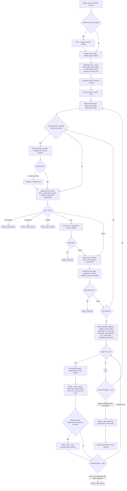

# Delivery — how a change moves, and how this repository ships

The procedure lives in the skills; this page is the map. The details belong to `deliver`
(`skills/deliver/references/loop.md` holds the run, size and question rules) and `plan-work`.

## The path of a change

```
request ─► route (CLAUDE.md) ─► plan-work? ─► deliver ─► /commit ─► pr-create ─► branch-flow finish
                                               │
                     triage: scenario, size S, risk axes, perimeter, test matrix
                     analysis: plan tasks, challenger, every question asked before the launch
                                               │
                     impl-review-loop: blocks of up to 4 tasks, each closed by the gate and read by reader A;
                     final verification; fix rounds, each verified → OK | STALL
                                               │
                     final gate · sweep · tests by level · verdict table · perimeter closed
```

| Step | Owner | Leaves behind |
| --- | --- | --- |
| route | the table in `CLAUDE.md` | nothing |
| plan, when worth one | `plan-work` | a plan file in `docs/plans/`, ignored by git (below) |
| triage and perimeter | `deliver` | `<git dir>/deliver/perimeter.md`, per worktree, never committed |
| implement and review | `impl-review-loop` workflow | the diff; `blocks`, `carried`, `defaultsApplied`, `findingsLog` for the session |
| tests and scope | `scripts/gate.mjs` | `<git dir>/deliver/gate.json` and `gate.log`, per worktree, never committed |
| leftovers | `scripts/sweep.mjs` | the closed process trees; a list of other processes for the owner |
| close | `scripts/perimeter.ps1 -Close -FindingsLog` | one line in `<git dir>/deliver/findings.jsonl`, read by `session-brief.js` and `/retro` |
| commit, PR, finish | `/commit`, `pr-create`, `branch-flow` | an Italian commit and PR, squash merge, source branch deleted |

Principles of the loop (from `loop.md`): **code decides what code can decide** (size, order, blocks, reader tiers,
the test gate), agents only judge; **one run per coherent request**, since a run has a large fixed cost; **a
finding is caught while its block is open**, and the expensive reader reads the whole diff once; and **only weighty
doubts reach the owner**: a reversible question with a default takes it mid-run and the verdict says so; data,
contract, money and security questions stop the run.

## The flow, with models and stall exits

Size S is the session's call and skips the blocks. At M and L the size comes from the plan: one block is M, more is
L; the risk axes lift S to M and raise the reader tiers. Model · effort sits in each node; "none" is code.



Reader B runs on Opus at M with a security or data axis, past 10 files or 600 lines (not mechanical), or with three
or more axes besides `logic`. A question from the implementer stops the run only on the `stop` side of
`questionPolicy`; the result lists the rest in `defaultsApplied`. Each STALL exit has its resume in
`skills/deliver/references/stall.md`; `STALL: question` (a `stop` question) is raised from any agent node. With `lanes: true` (independent task groups in parallel git worktrees, joined by `gate.mjs --merge`) two more exits exist: `merge-conflict` and `lane-setup`; a stall inside a lane keeps its own `why` and lists the lane worktrees, removed with `gate.mjs --lane-remove`. A start tree with staged changes, or with uncommitted edits in a file a task shares, runs serially or is refused by `--merge`.

## Plans are working files

A plan is a handoff between sessions, not documentation. `plan-work` writes it to `docs/plans/` and adds that
folder to the repository's `.git/info/exclude`, so it is never committed and leaves no trace in any repo's tree.
A decision that must outlive the work goes into the docs of the area it changes, or into the commit message.
In this repository `.gitignore` also lists `/docs/plans/`.

## Changing this repository

1. **Branch and worktree.** Never commit in the main clone: other sessions use it. One branch per change, in
   its own worktree (`branch-flow`).
2. **Gate**, from the worktree root:
   ```powershell
   node --test tools/*.test.mjs
   node tools/validate.mjs
   claude plugin test mods/cockpit      # when mods/cockpit changed
   ```
3. **Install and check** once the gate is green, so the live config runs the change straight away:
   ```powershell
   .\install.ps1 -Force
   .\install.ps1 -Check
   ```
4. **Commit** on the branch (`/commit`). Push and PR only when asked; the PR is squash-merged and the
   source branch deleted.
5. **Docs**: a change that moves a rule described in `docs/` or the README updates them in the same branch.
