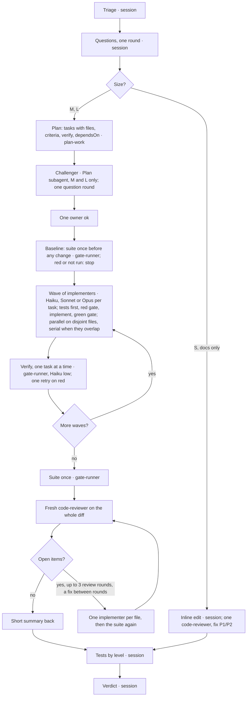

# Delivery — how a change moves, and how this repository ships

The procedure lives in the skills; this page is the map. The details belong to `deliver`
(`skills/deliver/SKILL.md` holds the triage, size and question rules) and `plan-work`.

## The path of a change

```
request ─► route (CLAUDE.md) ─► plan-work? ─► deliver ─► /commit ─► pr-create ─► branch-flow finish
                                               │
                     triage: scenario, size, risk axes, test matrix
                     every closed question asked once, in one round
                                               │
                     size S or docs only: inline edit, one reviewer
                     size M, L: plan, one owner ok, then the `build` workflow
                                               │
                     tests by level (real tests only after asking) · verdict
```

| Step | Owner | Leaves behind |
| --- | --- | --- |
| route | the table in `CLAUDE.md` | nothing |
| plan, when worth one | `plan-work` | a plan file in `docs/plans/`, ignored by git (below) |
| triage and questions | `deliver` | the one question round; the defaults taken are named in the verdict |
| implement and review | `build` workflow | the uncommitted diff and a short summary: status, tasks, suite, rounds, `stop` questions, open findings, `outside[]` |
| tests by level | `deliver`, with the `run` skill for real tests | the matrix levels `build` did not cover, run |
| commit, PR, finish | `/commit`, `pr-create`, `branch-flow` | a commit and PR in the configured language, squash merge, source branch deleted |

The penguin skills are entry points by name: `kowalski` analyses and plans, `skipper` runs the request through
`deliver`, `rico` reproduces and fixes a bug, `soldato` runs the tests.

## The flow, with models

Size S is the session's call (no plan, edited in place). M is a plan of up to 4 tasks, L more than 4; the risk axes
(`data`, `money`, `contract`, `security`, `concurrency`) lift S to M and pick the implementer's and reviewer's model. Every closed question is asked
before the build, so a run stops only on a `stop` question.



`build` returns `{ status: ok|stop|failed|error, tasks, assumedDone, suite, rounds, stops, openFindings, outside, filesChanged }`;
each task is `{ id, state, red }` plus `line` (the deciding line of a failed task) and `redLine` (the red check's line) when set.
Before any change it runs `testCmd` once: red, not run or no test ran ends the run `stop` with one `baseline` question and nothing built.
A verify or suite that ran zero tests is never green. A red suite is one open item with one fixer: the file its failing line names, else the first changed test file, else the first changed file.
On a run with a `data`, `money`, `contract` or `security` axis each review round adds a second `code-reviewer` (opus, high) that reads the change only for those axes; findings are merged and deduplicated, and if it returns nothing the run goes on with the first and says so in `outside`. The reviewer stays inside the change's perimeter: what it finds outside it (old defects, untouched code, unrequested improvements) is never fixed in the loop but returned as `outside` and shown to the owner in the verdict. `stop`
questions go to the owner in one round and `build` relaunches with just those tasks plus their skipped dependents, with the already-done ids in `done`; `failed` gets one relaunch,
then goes to the owner. The relaunch passes `red: true` and `redLine` on the tasks whose summary had `red: true`, so their tests-only step and red check are skipped;
it passes the previous summary's `filesChanged` as `doneFiles` (a finding there is fixed, not sent to `outside`; the new `filesChanged` carries them, so each relaunch passes only the latest one) and `baseline: false` (the earlier run already checked the suite).
A finding outside the declared files that the change caused (`causedByChange`) is an open finding with no fixer and ends the run `failed` (`stop` when a question is open too); it goes to the owner, never to a relaunch.
`suite` is `green`, `red: <line>`, `not run: <line>`, or a red line followed by `(suite fix held back until the stopped tasks are resolved)`.

## Plans are working files

A plan is a handoff between sessions, not documentation. `plan-work` writes it to `docs/plans/` and adds that
folder to the repository's `.git/info/exclude`, so it is never committed and leaves no trace in any repo's tree.
A decision that must outlive the work goes into the docs of the area it changes, or into the commit message.
In this repository `.gitignore` also lists `/docs/plans/`.

## Changing this repository

1. **Branch and worktree.** Never commit in the main clone: other sessions use it. One branch per change, in
   its own worktree (`branch-flow`).
2. **Gate**, from the worktree root:
   ```powershell
   node --test tools/*.test.mjs
   node tools/validate.mjs
   claude plugin test mods/cockpit      # when mods/cockpit changed
   ```
3. **Install and check** once the gate is green, so the live config runs the change straight away:
   ```powershell
   .\install.ps1 -Force
   .\install.ps1 -Check
   ```
4. **Commit** on the branch (`/commit`). Push and PR only when asked; the PR is squash-merged and the
   source branch deleted.
5. **Docs**: a change that moves a rule described in `docs/` or the README updates them in the same branch.
