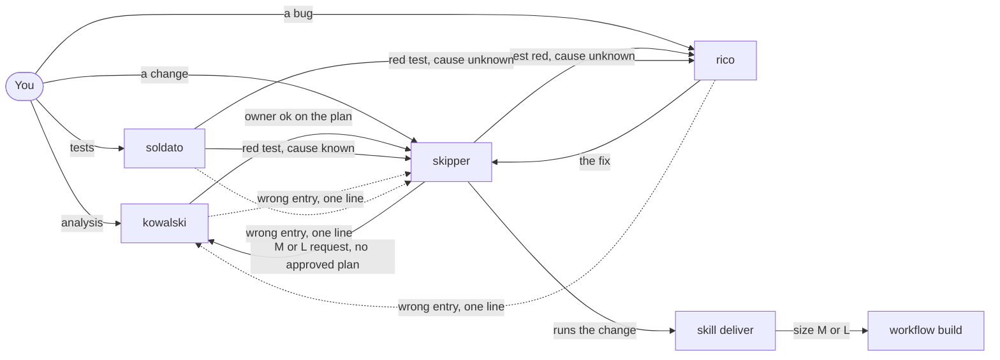
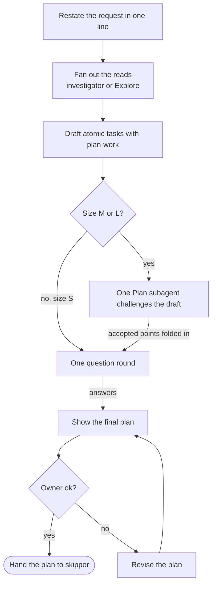
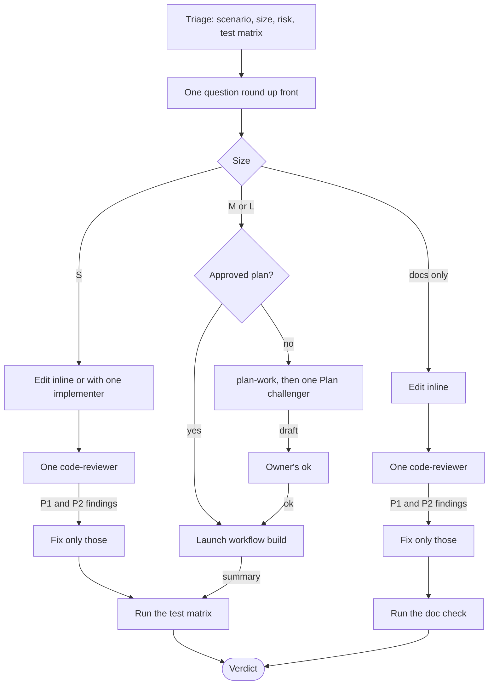
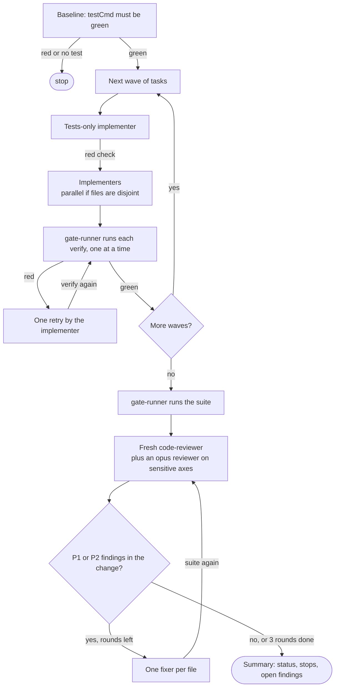
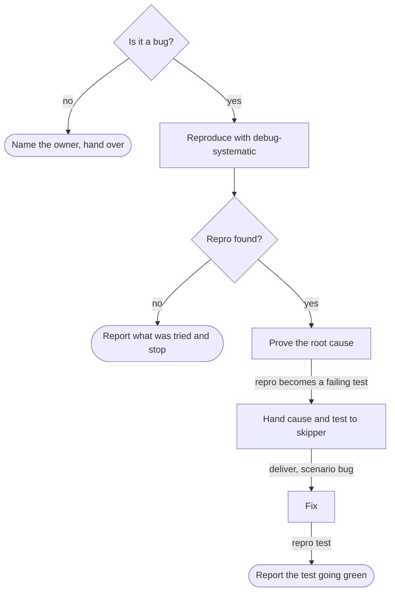
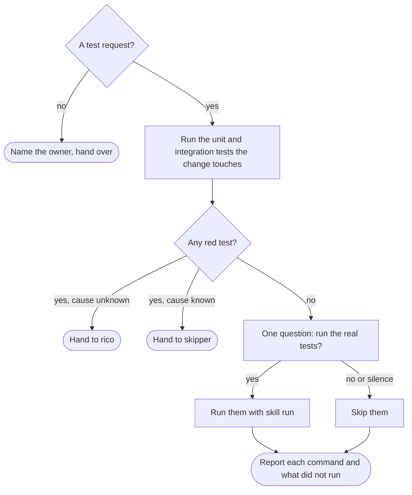
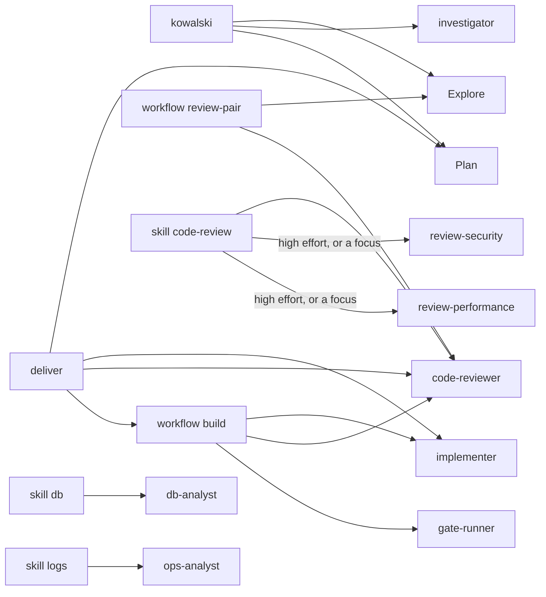

# How the kit works

Four penguins take a request from analysis to a tested change. The pictures below show who hands what to whom.

## 1. The penguins

| Penguin | Does | Never does | Call it |
| --- | --- | --- | --- |
| `kowalski` | Analysis and plan. Reads the code, asks one round of questions, drafts atomic tasks. | Edits code. Starts building without the owner's ok. | `/kowalski analizza [request]` |
| `skipper` | Coordination. Runs a request or an approved plan through `deliver` and reports the outcome. | Decides what `deliver` decides. Commits or pushes. | `/skipper implementa [request]` |
| `rico` | Bugs. Reproduces, proves the root cause, fixes with a repro test. | Fixes before the cause is proven. Ships a guessed fix. | `/rico sistema [bug]` |
| `soldato` | Tests. Runs the unit and integration tests of the change, then offers real tests. | Fixes a red test. Runs live or e2e tests unasked. | `/soldato testa [what]` |

The request can also come from the conversation. Then you type only the name.

## 2. Workflows

### a. Entry points and handoffs

Any penguin that gets a wrong-entry request names the right owner in one line and hands it over.

### b. kowalski

One challenger and one question round. There is never a debate loop.

### c. deliver by size

Every size ends in a verdict. M and L launch `build` and read only its summary.

### d. The `build` workflow

Findings outside the change go to the summary and are never fixed.

### e. rico

The repro test is the proof. A guessed fix never ships.

### f. soldato

Real tests hit live systems. They run only after a yes.

## 3. Who uses whom

A cell shows the model tier when a source states one. An empty cell means the column does not use the agent.

| Agent | kowalski | skipper / deliver S | deliver M/L | docs-only | build workflow | rico | soldato | review-pair |
| --- | --- | --- | --- | --- | --- | --- | --- | --- |
| `Explore` | haiku | | | | | | | haiku |
| `investigator` | sonnet | | | | | | | |
| `Plan` | opus, or sonnet with no risk axis | | opus, or sonnet with no risk axis | | | | | |
| `implementer` | | sonnet | | | haiku, sonnet or opus | | | |
| `code-reviewer` | | sonnet | | haiku | sonnet or opus, plus opus on sensitive axes | | | sonnet and opus |
| `gate-runner` | | | | | haiku | | | |
| `db-analyst` | | | | | | | | |
| `ops-analyst` | | | | | | | | |
| `review-performance` | | | | | | | | |
| `review-security` | | | | | | | | |

The M/L column shows the challenger only. Its implementers and reviewers run inside `build`.

Four agents have an empty row in the table. Other skills call them: `code-review` calls the two specialist reviewers, `db` runs in `db-analyst`, `logs` runs in `ops-analyst`.
